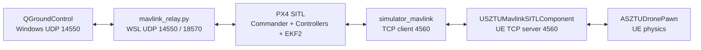

# PX4、UE5 与 QGroundControl 信息流

本文对应当前 `SZTUWindFieldPX4Demo` 的自研 HIL 桥接实现。AirSim 只作为架构参考，不在运行链路中。

## 运行拓扑

端口职责：

| 端口 | 方向 | 用途 |
|---|---|---|
| TCP `4560` | PX4 client <-> UE server | HIL 传感器、状态和电机输出 |
| UDP `18570` | relay/OFFBOARD -> PX4 | PX4 本地 MAVLink 控制入口 |
| UDP `14550` | PX4 <-> relay <-> Windows QGC | QGC 命令、参数和遥测 |

## 1. PX4 如何把控制信息传给 UE5

以 QGC 点击 Takeoff 为例：

1. QGC 发送 `MAV_CMD_NAV_TAKEOFF` 和解锁命令到 Windows UDP `14550`。
2. WSL 中的 `mavlink_relay.py` 把命令转发到 PX4 `127.0.0.1:18570`。
3. PX4 的 Commander、导航和多旋翼位置/姿态/角速度控制器计算电机输出。
4. PX4 `simulator_mavlink` 通过 TCP `4560` 发送 `HIL_ACTUATOR_CONTROLS`。
5. UE 的 `USZTUMavlinkSITLComponent::ProcessIncomingPackets()` 解码消息，把前四路 `controls[]` 保存为 `[0,1]` 电机指令。
6. `ASZTUDronePawn` 每帧读取四路指令，按 `推力 = 电机指令 * MaxMotorThrustN` 计算总推力和三轴力矩，再积分 UE 世界中的位置、速度和姿态。

关键源码：

- `D:\SZTUWindFieldPX4Demo\Unreal\Source\SZTUWindFieldPX4Demo\SZTUMavlinkSITLComponent.cpp`：131-142 行，解码 `HIL_ACTUATOR_CONTROLS`。
- `D:\SZTUWindFieldPX4Demo\Unreal\Source\SZTUWindFieldPX4Demo\SZTUDronePawn.cpp`：336-387 行，电机输出到推力、力矩和运动状态。
- `outputs/mavlink_relay.py`：QGC 与 PX4 的 UDP 双向转发。

自动悬停/绕圆的命令源有所不同：`outputs/takeoff_offboard.py` 直接向 PX4 UDP `18570` 发送 OFFBOARD 位置设定值，不需要 QGC 发轨迹；此后的 PX4 控制器到 UE5 的执行链路完全相同。

## 2. UE5 如何把高度和位置传给 QGC

1. `ASZTUDronePawn` 取得 UE 世界位置、速度、姿态、角速度和比力。
2. 位置由厘米转换为米；UE 使用 Z 向上，发给 PX4 的速度转换为 NED，Z 速度取反。
3. `SendDroneState()` 把本帧状态缓存到 `USZTUMavlinkSITLComponent`。
4. 组件经 TCP `4560` 周期发送：
   - `HIL_SENSOR`：约 250 Hz，IMU、磁场、气压和气压高度；
   - `HIL_GPS`：约 10 Hz，经纬度、高度和 NED 速度；
   - `HIL_STATE_QUATERNION`：约 50 Hz，姿态、位置、高度和速度；
   - `ODOMETRY`：约 50 Hz，以 UE 启动位置为局部原点，发送 `LOCAL_NED` 位置、速度和视觉协方差。
5. PX4 的模拟器驱动接收这些消息，EKF2 融合后发布 `vehicle_local_position`、`vehicle_global_position`、`vehicle_attitude` 等 uORB 状态。当前 `EKF2_EV_CTRL=6` 只融合视觉垂直位置和三维速度，不融合视觉水平位置；`EKF2_HGT_REF=3` 以视觉高度为高度参考；`EKF2_EVV_GATE=10` 允许地面初始化阶段的速度创新继续被融合。这样能约束 Z 轴低频漂移，又不改变 OFFBOARD 的水平坐标参考。
6. PX4 MAVLink 模块把融合状态、飞行模式和电池等遥测发往 WSL UDP `14550`。
7. `mavlink_relay.py` 转发到 Windows QGC UDP `14550`，QGC 才显示高度、地图位置和姿态。

关键源码：

- `D:\SZTUWindFieldPX4Demo\Unreal\Source\SZTUWindFieldPX4Demo\SZTUDronePawn.cpp`：452-460 行，速度的 NED 转换和状态发送入口。
- `D:\SZTUWindFieldPX4Demo\Unreal\Source\SZTUWindFieldPX4Demo\SZTUMavlinkSITLComponent.cpp`：172-405 行，三类 HIL 消息和 `ODOMETRY` 的打包发送。

因此，QGC 显示的是 **PX4 估计并通过 MAVLink 发布的状态**，不是 UE5 直接推送给 QGC 的 Transform。UE 另有 UDP `14660` JSON telemetry，供本项目的验证脚本读取；它不属于 QGC 链路。

## 排查顺序

| 现象 | 优先检查 |
|---|---|
| UE 不响应控制 | TCP `4560`、`HIL_ACTUATOR_CONTROLS`、四路电机值 |
| QGC 无遥测 | PX4 MAVLink 实例、relay 双向计数、Windows UDP `14550` |
| QGC 高度抖动但 UE 实际平稳 | EKF2 输出与 HIL_SENSOR/HIL_GPS/ODOMETRY 时间戳、坐标和融合状态 |
| UE 与 QGC 同时低频上下运动 | 先比较 `vehicle_local_position` 与 groundtruth，再检查 ODOMETRY、`EKF2_EV_CTRL=6`、`EKF2_HGT_REF=3` 和 `EKF2_EVV_GATE=10`；确认估计正常后才调 PID |
| 自动飞行正常但 QGC 命令无效 | 区分 OFFBOARD 脚本入口 `18570` 与 QGC relay 入口 `14550` |
