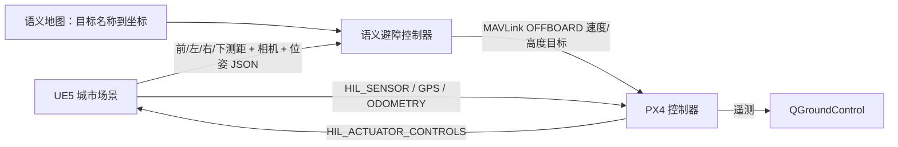

# 城市场景多传感器避障与语义驱动

## 目标

独立关卡 `/Game/Maps/SZTUUrbanSemanticScene` 用于后续两项实验：

1. 多传感器避障：UE 前/左/右三组射线扇区和下视测距提供实时距离；PX4 负责姿态与高度闭环；WSL 高层控制器根据距离修正水平速度。
2. 语义驱动：操作入口接收 `delivery_zone`、`medical_station` 等语义名称，从 `outputs/urban_semantic_map.json` 解析目标坐标并执行任务，而不是直接要求操作者填写 X/Y。

机载相机已挂在无人机前部。UE、PX4、路线规划器、任务命令和原始遥测始终使用原有内部坐标，不做重映射；网页显示层统一使用 `显示 X = 内部 X`、`显示 Y = -内部 Y`、`显示偏航 = -内部偏航`。因此后续修改页面朝向或标签时不需要重写飞行与规划逻辑。网页地图显示两排 10 栋建筑和中央障碍，右下角同时显示机载相机实时画面。UE 通过 `Saved/CameraFrames/current_run.txt` 标记当前运行目录，网页只读取该目录的 8 个环形帧，避免扫描历史截图。添加 `-OnboardCamera` 仍可让 UE 主窗口切换为第一视角。

控制器在水平飞行时会根据速度向量设置偏航角，使机头、机载相机和前向测距扇区与实际飞行方向一致；悬停时保持当前航向。语义区域在 UE 中使用无碰撞的空心地面标识，不再生成有厚度的实体色块。

水平接近不再依赖固定距离内切换固定速度。控制器根据剩余距离、实测水平速度、有效最大减速度和控制链响应延迟计算制动包络，再沿规划路线切线生成矢量速度，并使用实测速度反馈消除残余动量。偏航命令默认限制为每秒 `55°`；低于 `0.08 m/s` 时不发送新偏航目标。默认到点半径为 `0.25 m`，到点速度仍需不高于 `0.08 m/s`。

这些参数统一存放在 `scripts/semantic_runtime_config.json`。每次任务会生成
`run_manifest.json`，记录配置 SHA-256、请求风速、相机采集率及全部运行时
脚本哈希，避免报告与实际代码版本脱节。

## 一键运行

默认执行 A 起点到 B 配送区，途中必须绕过中央建筑并正常降落：

```powershell
powershell -NoProfile -ExecutionPolicy Bypass -File .\outputs\run_semantic_city.ps1
```

也可双击 `START_SEMANTIC_CITY.cmd`。

显示传感器射线：

```powershell
powershell -NoProfile -ExecutionPolicy Bypass -File .\outputs\run_semantic_city.ps1 -ShowSensorRays
```

切换机载相机并选择语义目标：

```powershell
powershell -NoProfile -ExecutionPolicy Bypass -File .\outputs\run_semantic_city.ps1 `
  -Goal medical_station -OnboardCamera
```

只检查文件、参数和 Python 语法：

```powershell
powershell -NoProfile -ExecutionPolicy Bypass -File .\outputs\run_semantic_city.ps1 -DryRun
```

## 回归任务集

一次执行 `outputs/test-plans` 内的全部语义任务：

```powershell
powershell -NoProfile -ExecutionPolicy Bypass -File .\outputs\run_semantic_regression.ps1
```

首次使用或只修改网页、文档、调度逻辑时，先运行不启动 UE/PX4 的检查：

```powershell
powershell -NoProfile -ExecutionPolicy Bypass -File .\outputs\run_semantic_regression.ps1 -DryRun
```

可通过 `-PlanNames clear_hover_land,multi_goal_return` 只选择部分计划；默认遇到首个失败即停止，添加 `-ContinueOnFailure` 后会继续执行剩余计划。当前矩阵包含 6 个计划，覆盖直达悬停降落、巡检门到医疗站、绕障往返、多目标返航以及两类视觉任务。每次执行会在 `outputs/semantic-regression/<run-id>` 生成总表、JSON 结果和每个计划的独立日志，并汇总耗时、碰撞数、最终误差、到点速度及与上一轮的指标变化。

报告还执行趋势门禁：碰撞、到点速度、最终误差超过配置阈值会返回
`CHECK`；同风速且任务集合完全相同的上一轮存在时，平均误差或耗时恶化超过
允许比例也会标记，避免拿单任务探针和完整矩阵做无效比较。

## 非零风场语义矩阵

城市地图默认保持无风。只有显式传入 `-WindMps` 时，GameMode 才会在
无人机初始化前注入隐藏可视化的风场 actor；风扇阵列和箭头不会遮挡城市。
若请求非零风但遥测平均风速低于请求值的 80%，任务强制返回 `CHECK`。

默认运行配置中的稳定风速 `3 / 5 / 8 m/s`：

```powershell
powershell -NoProfile -ExecutionPolicy Bypass `
  -File .\scripts\run_semantic_wind_matrix.ps1 -ContinueOnFailure
```

`10 m/s` 保留为压力检查，不属于稳定演示基线。

## 更换地图

风场注入、控制器和回归门禁不绑定城市地图。新地图需要继续使用
`ASZTUWindFieldGameMode` 与 `ASZTUDronePawn`，并提供同 schema 的语义地图
JSON（包括 `ue_map`、`origin_world_m`、`goals` 和 `obstacles`）。之后只需：

```powershell
powershell -NoProfile -ExecutionPolicy Bypass `
  -File .\scripts\run_semantic_wind_matrix.ps1 `
  -SemanticMapFile C:\maps\new_semantic_map.json `
  -ContinueOnFailure
```

脚本默认从 JSON 的 `ue_map` 字段选择 UE 地图，也可用 `-UeMap` 显式覆盖。
运行 manifest 会记录 UE 地图、语义 JSON 路径与 SHA-256。仪表盘同样接受
`--map` 和可选 `--ue-map`，目标白名单会从 JSON 动态读取。视觉确认仍要求
新地图提供当前检测器支持的地标外观；否则应先关闭视觉步骤或补充对应视觉资产。

## 故障与离线回归

```powershell
python .\scripts\verify_semantic_resilience_test.py
powershell -NoProfile -ExecutionPolicy Bypass `
  -File .\scripts\verify_semantic_fault_injection.ps1
```

检查覆盖配置 schema、坏任务计划、碰撞/速度/耗时门禁和启动前端口状态，
不需要启动 UE、PX4 或 QGC。

## 相机预览

默认采集率从统一配置读取，当前为 `2 Hz`；网页每 `400 ms` 发起条件请求，
使用 ETag 避免重复传输同一帧。UE 端将命令行覆盖限制在最多 `4 Hz`，防止
同步 GPU readback 干扰 HIL。该链路是低频任务观察画面，不宣称为驾驶级视频。
视觉任务在等待点做位置保持时仍持续发送指向目标的航向设定，避免非零风下
低速航向漂移令相机背向地标；到达等待点后若在 `vision-wait` 内仍未确认，
任务会立即安全失败并降落，不再空等到整段任务超时。

核心入口会自动识别两种目录：工作区的 `outputs/` 布局，以及 GitHub 仓库的 `scripts/ + scripts/test-plans/` 布局。仓库克隆后可以直接运行 `scripts/run_semantic_regression.ps1 -DryRun`；也可使用 `scripts/install_workspace_layout.ps1 -WorkspaceRoot <路径>` 映射成传统工作区结构。

## UE 冷启动阶段

验证器不再只等待固定秒数。启动日志会依次识别：

1. `process_started`：UnrealEditor 进程已启动。
2. `log_active`：UE 日志开始输出。
3. `shader_compiling`：正在编译或加载着色器。
4. `map_loaded_waiting_for_4560`：地图已进入运行态，等待 HIL 端口。
5. `tcp_4560_ready`：TCP 4560 已监听，可以启动 PX4。

若 UE 进程提前退出会立即失败；只有尚在推进的冷启动阶段才继续等待到总超时上限。

## 信息流



这里的“AI 控制”是可解释的规划与反应式基线：识别语义目标，先根据完整建筑与中央障碍地图规划安全折线，再用多方向测距处理地图外突发障碍。已有地图规划绕行点时，反应式控制不会覆盖该安全路线。后续接入视觉检测或学习策略时，保持相同的目标解析、PX4 控制与验收接口即可。

## 验收

每次运行输出到 `outputs/semantic-runs/<run-id>`：

- `summary.md`：最终 PASS/CHECK。
- `mission_result.json`：目标、避障次数、碰撞数、传感器样本数、降落和上锁状态。
- `perception_trace.jsonl`：UE 原始感知与位姿序列。
- `controller.log`：语义解析、绕障决策和导航过程。
- `px4_sitl.log`：PX4 起飞、模式与降落证据。

PASS 必须同时满足：到达语义目标、障碍碰撞为 0、感知样本不少于 20、正常落地并解除锁定。只有路线确实穿越已知障碍或传感器检测到突发障碍时，才额外要求存在规划绕行点或传感器避障证据；无障碍直达航段不为了“展示避障”而人为制造绕行动作。

## 地图重建

修改城市布局或语义地标后，先编译 Editor target，再运行：

```powershell
& "D:\Epic Games\UE_5.8\Engine\Binaries\Win64\UnrealEditor-Cmd.exe" `
  "D:\SZTUWindFieldPX4Demo\Unreal\SZTUWindFieldPX4Demo.uproject" `
  -run=SZTUWindFieldBuildMaps -UrbanMapOnly -unattended -nop4 -nosplash -NullRHI -NoSound
```

不要直接编辑 `.umap` 二进制文件；修改 `SZTUWindFieldBuildMapsCommandlet.cpp` 后重建。
