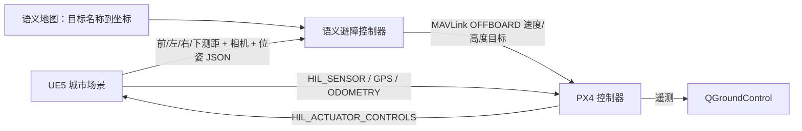

# 城市场景多传感器避障与语义驱动

## 目标

独立关卡 `/Game/Maps/SZTUUrbanSemanticScene` 用于后续两项实验：

1. 多传感器避障：UE 前/左/右三组射线扇区和下视测距提供实时距离；PX4 负责姿态与高度闭环；WSL 高层控制器根据距离修正水平速度。
2. 语义驱动：操作入口接收 `delivery_zone`、`medical_station` 等语义名称，从 `outputs/urban_semantic_map.json` 解析目标坐标并执行任务，而不是直接要求操作者填写 X/Y。

机载相机已挂在无人机前部。UE 默认观察相机从场景 `+Y` 侧看向 `-Y`；网页地图采用相同上下方向，并显示两排 10 栋建筑和中央障碍。网页右下角同时显示机载相机实时画面。UE 通过 `Saved/CameraFrames/current_run.txt` 标记当前运行目录，网页只读取该目录的 8 个环形帧，避免扫描历史截图。添加 `-OnboardCamera` 仍可让 UE 主窗口切换为第一视角。

控制器在水平飞行时会根据速度向量设置偏航角，使机头、机载相机和前向测距扇区与实际飞行方向一致；悬停时保持当前航向。语义区域在 UE 中使用无碰撞的空心地面标识，不再生成有厚度的实体色块。

## 一键运行

默认执行 A 起点到 B 配送区，途中必须绕过中央建筑并正常降落：

```powershell
powershell -NoProfile -ExecutionPolicy Bypass -File .\outputs\run_semantic_city.ps1
```

也可双击 `START_SEMANTIC_CITY.cmd`。

显示传感器射线：

```powershell
powershell -NoProfile -ExecutionPolicy Bypass -File .\outputs\run_semantic_city.ps1 -ShowSensorRays
```

切换机载相机并选择语义目标：

```powershell
powershell -NoProfile -ExecutionPolicy Bypass -File .\outputs\run_semantic_city.ps1 `
  -Goal medical_station -OnboardCamera
```

只检查文件、参数和 Python 语法：

```powershell
powershell -NoProfile -ExecutionPolicy Bypass -File .\outputs\run_semantic_city.ps1 -DryRun
```

## 信息流



这里的“AI 控制”是可解释的规划与反应式基线：识别语义目标，先根据完整建筑与中央障碍地图规划安全折线，再用多方向测距处理地图外突发障碍。已有地图规划绕行点时，反应式控制不会覆盖该安全路线。后续接入视觉检测或学习策略时，保持相同的目标解析、PX4 控制与验收接口即可。

## 验收

每次运行输出到 `outputs/semantic-runs/<run-id>`：

- `summary.md`：最终 PASS/CHECK。
- `mission_result.json`：目标、避障次数、碰撞数、传感器样本数、降落和上锁状态。
- `perception_trace.jsonl`：UE 原始感知与位姿序列。
- `controller.log`：语义解析、绕障决策和导航过程。
- `px4_sitl.log`：PX4 起飞、模式与降落证据。

PASS 必须同时满足：到达语义目标、至少存在一个地图规划绕行点或传感器避障事件、障碍碰撞为 0、感知样本不少于 20、正常落地并解除锁定。

## 地图重建

修改城市布局或语义地标后，先编译 Editor target，再运行：

```powershell
& "D:\Epic Games\UE_5.8\Engine\Binaries\Win64\UnrealEditor-Cmd.exe" `
  "D:\SZTUWindFieldPX4Demo\Unreal\SZTUWindFieldPX4Demo.uproject" `
  -run=SZTUWindFieldBuildMaps -UrbanMapOnly -unattended -nop4 -nosplash -NullRHI -NoSound
```

不要直接编辑 `.umap` 二进制文件；修改 `SZTUWindFieldBuildMapsCommandlet.cpp` 后重建。
